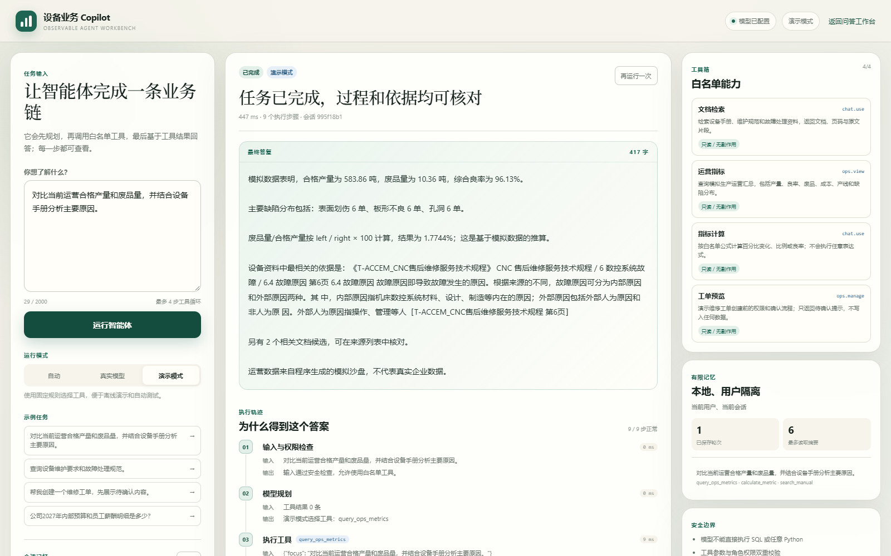
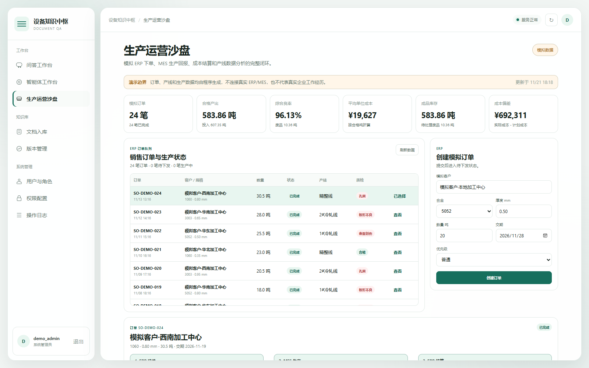
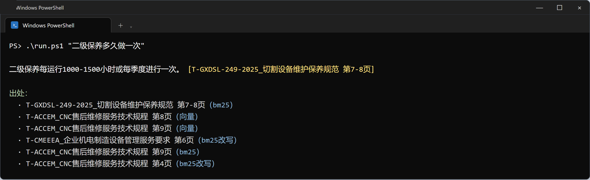
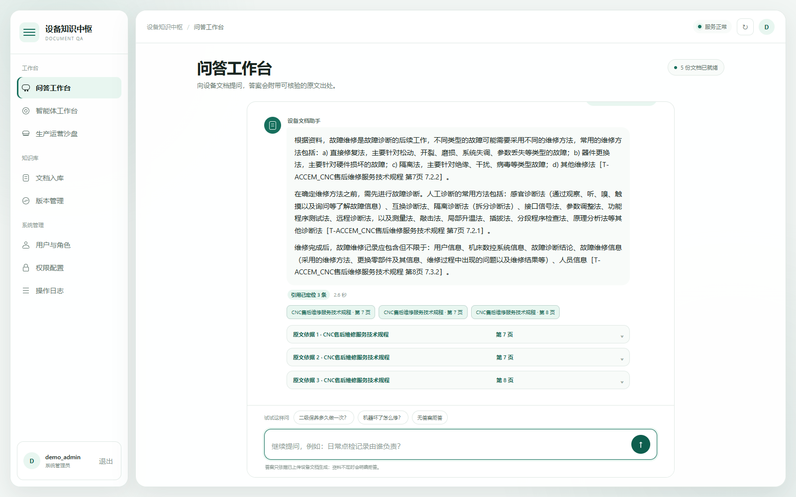

# EquipmentDoc QA

**让设备说明书、维护规程和售后标准“会回答问题”。**

An observable document RAG and tool-using Agent MVP for manufacturing knowledge and mock ERP/MES operations.



## 核心能力

- **可追溯文档问答**：解析、清洗、审核并发布设备 PDF，回答附带文档、章节和页码；资料不足时拒答。
- **可观测多工具 Agent**：使用 LangGraph 编排安全检查和工具循环，串联文档检索、模拟运营指标、白名单计算和工单预览。
- **制造业业务沙盘**：用模拟 ERP/MES 链路串联订单、工单、报工、质检、成本、库存和运营看板。

## 快速开始

```powershell
git clone https://github.com/duquxian123/equipment-doc-qa.git
cd equipment-doc-qa
py -3.12 -m venv .venv
.\.venv\Scripts\python.exe -m pip install -r requirements.txt
Copy-Item .env.example .env
notepad .env
.\.venv\Scripts\python.exe scripts\prepare_demo.py
.\run_api.ps1
```

`prepare_demo.py` 会下载 README 文末列出的 5 份公开 PDF，校验 SHA-256，然后构建解析、知识块和向量索引，不在仓库内重新分发 PDF。

启动后打开 <http://127.0.0.1:8000/> 并创建第一个管理员。配置 DeepSeek 密钥后可使用完整问答；进入 `/agent` 选择“演示模式”时，不需要真实模型调用即可查看工具链。

## 项目证据

| 文档 | 知识块 | RAG 回归 | Agent 评估 | 自动测试 |
| ---: | ---: | ---: | ---: | ---: |
| 5 份 / 83 页 | 239 | 11 题 | 8 条 | 16 项 |

> 这是本地验证型 MVP，不是可直接承载企业生产业务的正式平台。运营数据全部由程序生成；公开资料、模拟数据与真实企业项目严格区分。

使用者可以用自然语言查询设备参数、维护周期和故障处理办法。系统给出的答案会附上文档名称、章节和页码，点击引用即可核对原文；资料中没有依据时，系统会明确说“没有”，而不是猜一个答案。

项目还内置一套模拟 ERP/MES 生产运营沙盘，用于演示订单、生产、质检、成本、库存和设备知识查询如何连成一条业务闭环。

> 这是本地验证型 MVP，不是可直接承载企业生产业务的正式平台。生产沙盘中的数据全部由程序生成，不代表真实企业数据或项目经历。

## 能解决什么问题

| 场景 | 使用方式 | 获得什么 |
| --- | --- | --- |
| 查询设备维护要求 | 直接提问，例如“二级保养多久做一次？” | 明确结论、依据文档和页码 |
| 查询故障处理方法 | 使用口语描述故障，例如“机器坏了怎么修？” | 相关检查、诊断和维修规范 |
| 管理内部设备文档 | 上传 PDF，检查清洗与切片结果后发布 | 可搜索、可追溯的内部知识库 |
| 防止答非所问 | 查询文档中没有的信息 | 系统明确拒答，不编造答案 |
| 演示生产业务闭环 | 创建模拟订单、下发工单、提交报工和质检 | 良率、成本、库存和运营看板 |
| 从质量问题查规范 | 点击不合格订单的“查询处理规范” | 自动带着缺陷问题进入文档问答 |

## 智能体工作台

项目在 `/agent` 提供一个可观察、可评估的本地业务 Agent。它使用 LangGraph 编排 DeepSeek 原生 Function Calling，把设备文档检索、模拟运营指标和专业计算串成一条最多 4 步的工具循环；每条步骤、文档来源、权限拒绝和失败原因都会展示在工作台中。

工作台包含：

- `live`：真实模型工具调用；
- `demo`：固定规则演示，断网或模型接口异常时仍可运行；
- 用户隔离的本地 SQLite 会话摘要；
- 工具白名单、参数校验、角色权限和输入注入拦截；
- 只生成预览、不实际写入的维修工单确认样例；
- 8 条可重复执行的 Agent 评估任务。

Vue 3 页面采用本地生产构建文件，不需要 Node.js。架构、两分钟演示稿、API 和实测结果见 [智能体工作台文档](docs/agent-workbench.md)。

```powershell
.\run_api.ps1
```

登录后访问：**<http://127.0.0.1:8000/agent>**

可以用这些问题快速体验：

- 二级保养多久做一次？
- CNC 每年保养对床台平面度有什么要求？
- 机器坏了怎么修？
- 日常点检记录应该由谁做、记在哪里？
- 灭火剂的保质期是几年？（用于验证无答案时拒答）

## 功能一览

| 功能 | 主要用途 |
| --- | --- |
| 问答工作台 | 用自然语言提问，查看答案、引用片段和 PDF 原文 |
| 文档入库 | 上传 PDF，自动解析、清洗、切片，人工审核后发布 |
| 索引版本 | 保存每次发布的知识库版本，必要时回滚 |
| 生产运营沙盘 | 模拟 ERP 下单、MES 工单、生产回报、质检、成本和库存 |
| 用户与角色 | 区分普通用户、知识管理员和系统管理员 |
| 操作日志 | 查询登录、问答、文档发布、用户管理等操作记录 |

系统采用“先检索资料、再生成答案”的方式。原始问题和改写后的问题会分别查找相关内容，再将候选资料交给大模型组织答案。比较口语化的问法也能更容易找到书面规范。

## 使用流程


日常使用分为两条路径：

1. **知识管理员**负责准备资料：上传 PDF、检查清洗和切片结果、发布新版本。
2. **普通用户**负责使用资料：直接提问、查看出处，或进入生产沙盘查看订单和运营指标。

## 完整使用说明

### 1. 准备环境

建议使用 Windows 10/11，并准备：

- Python 3.12；
- 一个可用的 DeepSeek API Key；
- 需要入库的设备说明书或规范 PDF；
- 首次安装时的互联网连接，用于下载 Python 依赖和向量模型。

PDF 应包含可复制的文字。目前不支持 OCR，扫描件、图片型 PDF 和图片内容无法被正确解析。

### 2. 安装项目

在项目目录中打开 PowerShell，依次执行：

```powershell
py -3.12 -m venv .venv
.\.venv\Scripts\python.exe -m pip install -r requirements.txt
Copy-Item .env.example .env
notepad .env
```

在打开的 `.env` 文件中，将 `DEEPSEEK_API_KEY` 改成自己的密钥：

```dotenv
DEEPSEEK_API_KEY=你的密钥
DEEPSEEK_BASE_URL=https://api.deepseek.com
DEEPSEEK_MODEL=deepseek-chat
```

不要将 `.env` 上传到代码仓库。依赖、缓存和向量模型都保存在项目目录内，不会安装到系统 Python 环境。

### 3. 启动系统

```powershell
.\run_api.ps1
```

保持 PowerShell 窗口开启，然后在浏览器打开：

**<http://127.0.0.1:8000/>**

如果 8000 端口已被占用，可以改用：

```powershell
.\run_api.ps1 -Port 8001
```

此时访问 `http://127.0.0.1:8001/`。

### 4. 创建第一个管理员

第一次打开系统时，页面会要求创建第一个账号。规则如下：

- 用户名长度为 3–32 个字符；
- 密码至少 8 个字符；
- 第一个账号自动成为“系统管理员”。

创建完成后即可登录。关闭浏览器不会删除账号，下次启动继续使用同一账号即可。

### 5. 入库第一批文档

如果已经运行 `scripts/prepare_demo.py`，公开样例、知识块和索引会直接准备好；也可以通过以下页面流程上传自己的 PDF。

知识管理员或系统管理员可以进入“文档入库”：

1. 拖入 PDF，或点击上传区选择文件。
2. 等待系统完成解析、清洗和切片。
3. 在“清洗结果”中检查页眉、页码、目录和误删除内容。
4. 在“切片结果”中检查知识块是否完整，必要时修改章节名或排除错误内容。
5. 点击 **发布到问答**。
6. 看到“已发布”并在“已入库文档”中确认状态正常后，即可开始提问。

单份 PDF 最大 50 MB。系统会识别重复文件，避免同一资料重复入库。

不确定如何调整时，建议保留“标准清洗”和“标准平衡”预设。只有在发现有效内容被误删、知识块过短或过长时，再切换其他预设。

### 6. 开始提问

进入“问答工作台”，输入问题并发送。建议在问题里带上设备类型和具体关注点，例如：

- “切割设备二级保养的周期是多少？”
- “CNC 设备每年保养需要检查哪些项目？”
- “出现厚度超差时，应检查哪些设备、工艺参数和维护记录？”

答案下方会显示实际引用的文档、章节和页码。展开引用可查看原文片段，并打开对应 PDF 页面核对。

### 7. 体验生产运营沙盘

登录后进入“生产运营沙盘”。系统首次启动会生成 24 笔模拟历史订单，不需要连接 ERP 或 MES。



完整演示流程：

1. 创建一笔模拟销售订单，填写客户、合金、厚度、数量和交期。
2. 选择订单并分配到模拟产线，系统生成唯一 MES 工单。
3. 对生产中工单提交投入量、合格产出、废品、停机、能耗和质检结果。
4. 系统自动计算良率、材料成本、能耗成本、停机损失、总成本、吨成本和成本偏差。
5. 成品与废品库存同步更新，运营看板自动刷新。
6. 质检不合格时，点击“查询处理规范”，相关缺陷问题会预填到问答工作台。

普通用户可以查看沙盘数据；知识管理员和系统管理员可以创建订单、下发工单和提交报工。

## 角色与权限

| 角色 | 可以使用 |
| --- | --- |
| 普通用户 | 文档问答、查看引用 PDF、查看生产运营沙盘 |
| 知识管理员 | 普通用户功能，以及文档上传/审核/发布、版本回滚、订单和报工管理 |
| 系统管理员 | 全部功能，以及用户、角色和操作日志管理 |

系统管理员可在“用户与角色”页面新增用户、调整角色、启停账号和重置密码。为避免系统失去管理入口，最后一个有效系统管理员不能被停用或降级。

## 一个真实回答示例

```text
问题：二级保养多久做一次？

二级保养每运行 1000–1500 小时或每季度进行一次。
［切割设备维护保养规范 第 7–8 页］
```



普通 Web 问答同样会返回结构化引用：



如果问题超出已入库资料的范围，系统会回答“资料中没有相关内容”，不会用常识或其他文档补答案。由原文数据计算出的结果会单独标记为“推算，非原文”。

## 本地数据与隐私

| 内容 | 默认位置 |
| --- | --- |
| 模型配置与密钥 | `.env` |
| 已发布 PDF | `corpus/` |
| 账号、会话和操作日志 | `output/app.db` |
| 模拟订单、生产、质检和成本数据 | `output/ops.db` |
| 知识块、向量索引和版本快照 | `output/` |

文件内容保存在本机，但提出问题时，检索到的相关原文片段以及问题会发送到所配置的 DeepSeek 接口用于生成答案。不要向未经授权的第三方模型服务上传敏感或涉密文档。

服务默认只监听 `127.0.0.1:8000`，同一局域网内的其他电脑不能直接访问。如需备份，请备份整个 `corpus/`、`output/` 和 `.env` 文件，并妥善保管。

## 使用边界

当前版本适合本地演示、流程验证和小规模资料试用，以下能力尚未提供：

- OCR、扫描件识别和图片内容提取；
- 高并发、公网部署、SSO 和租户隔离；
- 按单份文档配置访问权限；
- 真实 ERP/MES、PLC/SCADA、采购、财务和完整 BOM 集成；
- 生产环境监控、告警和自动容灾。

跨页表格可能被切成两块；非常口语化或文档中从未出现的表达也可能检索不到。内置的 11 道人工回归题用于验证流程，不代表正式生产准确率。

## 常见问题

**页面提示缺少密钥或服务未就绪**

检查 `.env` 中的 `DEEPSEEK_API_KEY` 是否已替换为有效密钥，并确认 `.env` 与 `run_api.ps1` 位于同一项目目录。

**文档上传后没有出现在问答结果中**

上传只会生成审核草稿。确认已经完成审核，并点击“发布到问答”。发布后系统会为该文档生成正式索引。

**上传成功但检索不到内容**

先确认 PDF 可以复制文字，再检查清洗是否误删正文、切片是否过短或过长。扫描件目前无法使用。

**页面打不开或端口冲突**

确认启动窗口没有报错。若 8000 端口被占用，使用 `.\run_api.ps1 -Port 8001` 换一个端口。

**想恢复初始演示数据**

先停止服务并备份 `output/app.db` 与 `output/ops.db`，再按需移除数据库文件重新初始化。知识块和索引也可通过重新入库或运行索引脚本重建。

<details>
<summary><strong>技术信息、API 与批量建库</strong></summary>

### 技术组成

- FastAPI 提供本地 Web 与 REST API；
- SQLite 保存账号、审计和模拟生产数据；
- BM25 与 `BAAI/bge-small-zh-v1.5` 向量检索提供双路召回；
- NumPy 保存当前规模的向量矩阵，不依赖独立向量数据库；
- DeepSeek 负责查询改写和基于材料的回答生成。

### 批量索引

如果已有专用语料目录，也可以用命令行一次性建库：

```powershell
.\.venv\Scripts\python.exe src\parse_pdf.py
.\.venv\Scripts\python.exe src\clean_md.py
.\.venv\Scripts\python.exe src\chunk.py
.\.venv\Scripts\python.exe src\build_vector_index.py
```

### 命令行问答

```powershell
.\run.ps1 "二级保养多久做一次"
```

### API

服务启动后可访问：

- Web 工作台：<http://127.0.0.1:8000/>
- Swagger 接口文档：<http://127.0.0.1:8000/docs>
- 健康检查：<http://127.0.0.1:8000/health>
- 文档列表：<http://127.0.0.1:8000/documents>
- 问答接口：`POST /ask`

所有业务接口都需要本地登录会话。文档审核还提供 `/jobs/{id}/review`、`/clean`、`/rechunk`、`/publish` 和 `/discard`；生产沙盘提供 `/ops/orders`、`/ops/dashboard` 和 `/ops/work-orders/{id}/complete`。

### 自动测试

```powershell
.\.venv\Scripts\python.exe -m unittest discover -s tests -v
```

生产运营的详细设计见：

- [业务流程与接口](docs/production-operations/business-flow-and-api.md)
- [数据分析说明](docs/production-operations/data-analysis.md)
- [数字化项目一期方案](docs/production-operations/project-plan.md)

</details>

## 示例 PDF

以下链接直接指向互联网上的 PDF 文件。联网电脑无需启动本项目，也无需本地 `corpus/` 目录；浏览器支持 PDF 时会直接展示内容，并可从浏览器阅读器下载。

- [CNC 售后维修服务技术规程（T/ACCEM 334—2024）](https://www.ttbz.org.cn/upload/file/20241012/6386434189092523249849402.pdf#page=1&zoom=page-width)
- [企业机电制造设备管理服务要求（T/CMEEEA 004—2025）](https://www.ttbz.org.cn/upload/file/20250401/6387910422312619315429443.pdf#page=1&zoom=page-width)
- [汽车零部件制造通用技术规范（T/CMEEEA 199—2026）](https://www.ttbz.org.cn/upload/file/20260306/6390840910509235657307827.pdf#page=1&zoom=page-width)
- [切割设备维护保养规范（T/GXDSL 249—2025）](https://www.ttbz.org.cn/upload/file/20251212/6390115620704125083126838.pdf#page=1&zoom=page-width)
- [威特龙七氟丙烷灭火设备使用说明书](http://www.vitalong.cn/upfile/att/2017030119355321b1c.pdf#page=1&zoom=page-width)

以上 PDF 分别由[全国团体标准信息平台](https://www.ttbz.org.cn/)和[威特龙消防安全科技](http://www.vitalong.cn/)公开提供，内容已与项目示例语料做文件哈希校验。资料版权归原发布方，仓库不收录 PDF 本体，使用前请自行确认授权和使用范围。

## License

[MIT](LICENSE)
