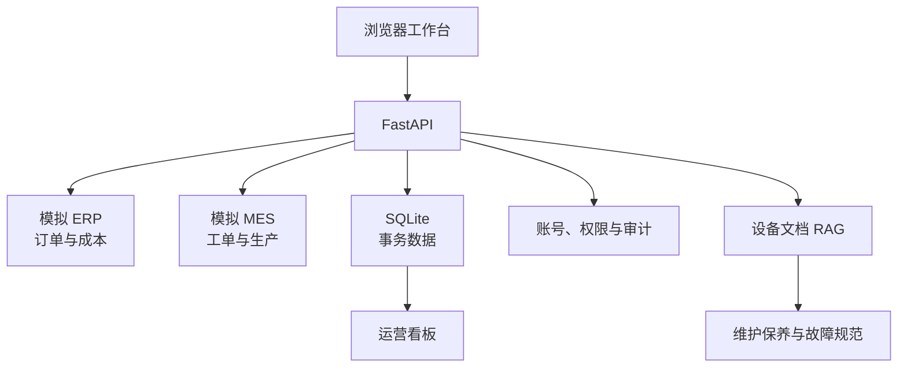

# 铝卷生产数字化项目一期方案

> 本方案服务于 EquipmentDoc QA 的模拟演示，不是任何真实企业的正式项目建议书。

## 1. 项目背景

模拟企业在订单、生产、质量、库存和成本之间依赖人工传递数据，可能出现：

- 销售订单与生产工单无法一一对应；
- 报工和质检结果回传不及时；
- 库存与成本不能随生产完成同步更新；
- 良率、缺陷和停机数据分散；
- 质量问题发生后，难以及时找到设备维护或工艺规范。

## 2. 一期目标

| 目标 | 验收指标 |
| --- | --- |
| 打通订单到生产的信息流 | 销售订单可生成唯一 MES 工单 |
| 打通生产到成本的回流 | 报工后自动计算良率、成本并更新库存 |
| 建立基础运营分析 | 页面能按产线和缺陷类型查看指标 |
| 建立知识联动 | 从质量异常可以带问题进入设备文档问答 |
| 保证数据一致性 | 重复下发、重复报工和非法数量被拒绝 |

## 3. 一期范围

### 包含

- ERP 销售订单；
- MES 生产工单；
- 产量、停机、能耗和班次回报；
- 质检结论和缺陷类型；
- 模拟成本计算；
- 成品/废品库存流水；
- 订单、产线和缺陷分析看板；
- 操作日志和接口权限；
- 与设备文档问答的页面联动。

### 不包含

- 采购、财务凭证、应付应收和完整 BOM；
- 真实设备 PLC/SCADA 采集；
- 复杂排产、APS 或多工序工艺路线；
- 返工、报废审批和批次追踪全流程；
- SAP、用友、金蝶等商业 ERP 适配；
- 真实企业主数据和成本口径。

## 4. 总体架构

## 5. 里程碑

| 阶段 | 交付物 | 验收 |
| --- | --- | --- |
| 1. 业务流程 | 状态、角色、字段和接口约定 | 订单可下发，重复下发被拒绝 |
| 2. 生产回报 | 报工、质检、成本和库存写入 | 一次事务完成全部更新 |
| 3. 运营看板 | 产量、良率、缺陷、产线和趋势 | 指标随新订单实时变化 |
| 4. 知识联动 | 异常问题带入 RAG 问答 | 问题已预填并可检索规范 |
| 5. 验证交付 | 自动测试、README、模拟数据说明 | 全链路测试通过 |

## 6. 角色与权限

| 角色 | 演示权限 |
| --- | --- |
| 普通用户 | 查看订单、看板和分析 |
| 知识管理员 | 创建订单、下发工单、提交报工 |
| 系统管理员 | 全部生产运营权限和操作日志 |

真实项目应进一步拆分为销售、计划、车间、质检和财务角色，并通过企业统一身份认证接入。

## 7. 数据治理

- 订单号、工单号、报工号和成本快照分别生成唯一标识；
- 订单与工单保持一对一约束；
- 生产与质检回报保持一对一约束；
- 通过事务保证生产、质量、成本和库存同时成功或同时回滚；
- 记录 ERP→MES、MES→ERP 与库存成本更新的集成事件；
- 所有操作写入现有审计日志。

## 8. 风险与控制

| 风险 | 控制 |
| --- | --- |
| 重复下发导致重复生产 | 订单状态检查 + 工单唯一约束 |
| 重复报工导致重复入库 | 工单状态检查 + 报工唯一约束 |
| 成本和库存只更新一半 | 单事务写入 |
| 模拟数据被误认为真实经历 | 页面、README、文档和代码中明确声明 |
| 演示范围膨胀 | 一期只做订单到成本的一条垂直链路 |

## 9. 验收标准

- 原有文档问答和自动测试继续通过；
- 页面上可创建一笔订单；
- 同一订单不能重复下发；
- 已下发工单可以提交生产和质检结果；
- 良率、成本、成品库存和废品库存计算正确；
- 看板能看到不少于 20 笔模拟历史和最新变化；
- 新业务链路具有自动化测试；
- README 能指导启动、操作和演示；
- 项目内明确标注模拟项目属性。
